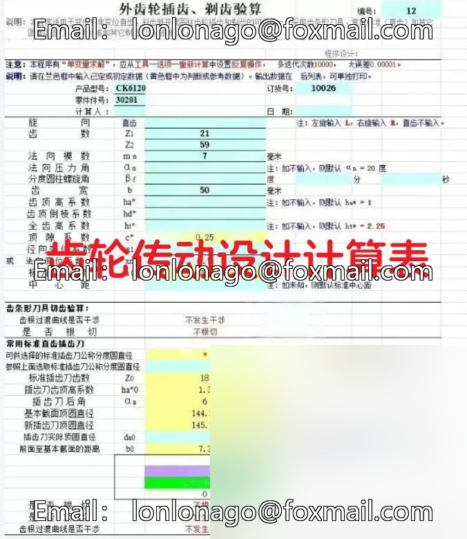
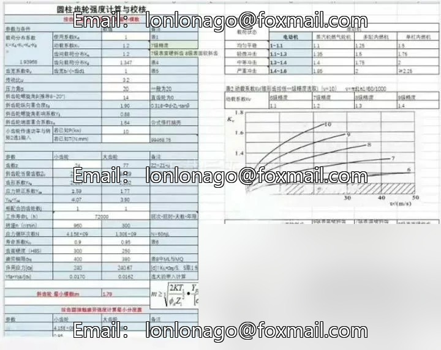
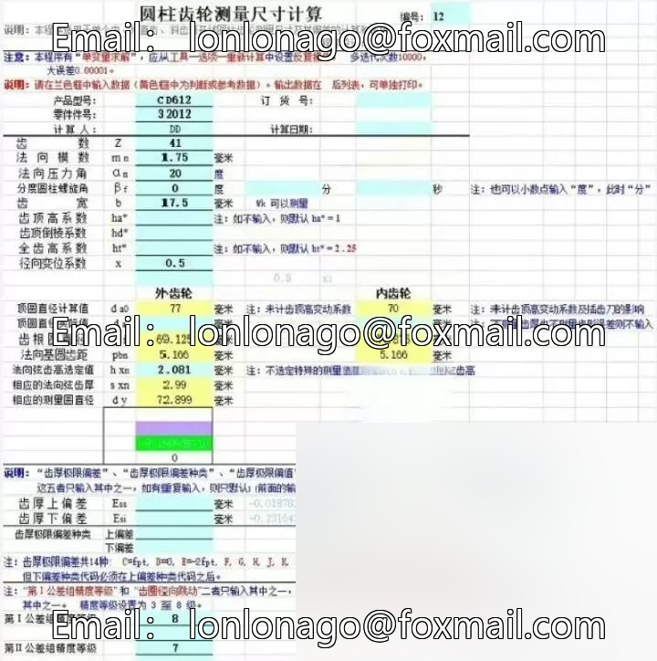
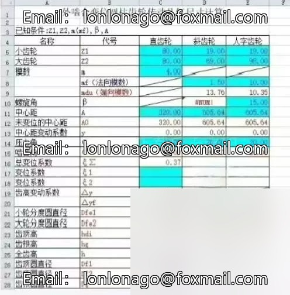
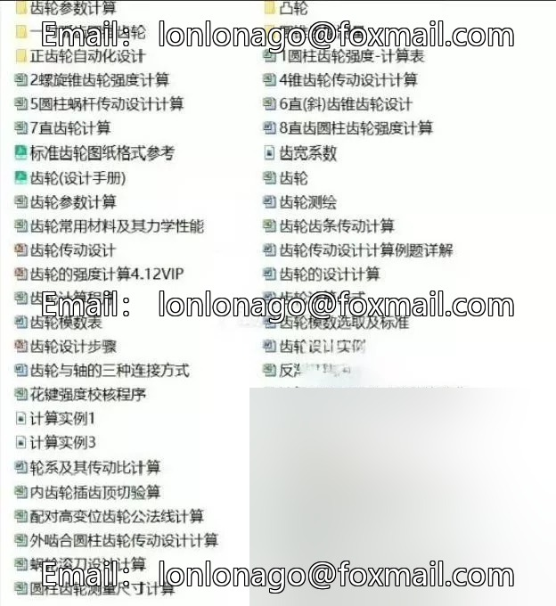

# Gear transmission design calculation table formula module table parameter cone measurement cylinder surveying tooth bar wheel system

## Body

Gear transmission design calculation tables and formulas modulus table parameters cone measuring cylinder surveying teeth bar wheel system
Total 52 items
Document content (includes excel, word, ppt):
Gear parameter calculation
A pair of arc tooth cone gears
Positive gear automation design
Cylinder worm gear transmission design calculation
Straight gear calculation
Standard gear drawing format reference
Gear (design manual)
Helical cone gear strength calculation
Gear strength calculation
Gear calculation program
Gear modulus table
Gear design steps
Three types of connection methods between gears and shafts
Hybond strength verification program
Calculation example 1
Gear parameter calculation
Common materials and mechanical properties of gears
Gear transmission design
Wheel system and transmission ratio calculation
Pair matching gear offset parallel normal calculation
Outer meshing cylindrical gear transmission design calculation

Bice Roll Knife Design Calculation
Cylindrical Gear Measurement Dimension Calculation
Cam
Cone Gear Measurement
Cylindrical Gear Strength-Calculation Table
Internal Gear Implant Point Cut Verification
Cone Gear Transmission Design Calculation
Direct (Straight) Cone Gear Design
Direct Cylinder Gear Strength Calculation
Belt Width Factor
Gear Surveying
Gear Tooth Rule Transmission Calculation
……

web-based shipment, can be directly photographed and shipped.

The gear design calculation tables include formulas, modular tables and parameters, covering conical, cylindrical, rack and other measurement and calculation aspects across multiple design procedures.

<!-- AI_ENRICHED -->

## Images

## Payment

Here is a pay link on Stripe ( https://buy.stripe.com/3cs8yP7sY87d0vu9AB ). Please contact me lonlonago@foxmail.com after funding $89, and I will send you a complete data files , thank you!

